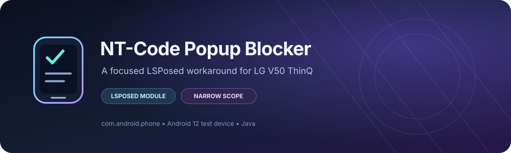

  

  
  
  
  
  

# NT-Code Popup Blocker

A small LSPosed module for the LG V50 ThinQ that suppresses one specific LG NT-Code warning dialog in the Phone Services process. It is designed to leave unrelated dialogs untouched by checking the dialog title and message before suppressing it.

> **Important:** This module hides the matching warning only. It does **not** repair NT-Code, carrier matching, firmware, modem, or the underlying carrier configuration.

## Download

**[Get the latest release APK](https://github.com/mchasby/LG-V50-NTCode-Popup-Blocker/releases/latest)**

Releases are published from version tags. If no release has been published yet, check the [Actions tab](https://github.com/mchasby/LG-V50-NTCode-Popup-Blocker/actions) for the latest successful build artifact.

## Features

- Targets the Android package `com.android.phone` only.
- Checks for the title `WARNING!` and the message fragments `Can't find matched carrier` and `Check NT-Code: 0`.
- Attempts to suppress only the matching `AlertDialog`.
- Includes a GitHub Actions workflow to build the APK and attach it to tagged releases.

## Compatibility

| Item | Details |
|---|---|
| Intended device | LG V50 ThinQ |
| User-reported test device | LG V50 ThinQ LM-V500VM, Android 12 |
| Root / framework | Magisk with Zygisk and LSPosed |
| Required LSPosed scope | `Call services` (`com.android.phone`) only |
| Not required | `System Framework` scope |
| Application ID | `com.nrowa.ntcodepopup` |

Compatibility with other LG models, Android versions, ROMs, or LSPosed versions has not been established.

## Installation

1. Download the APK from [Releases](https://github.com/mchasby/LG-V50-NTCode-Popup-Blocker/releases/latest).
2. Install the APK on the phone.
3. Open LSPosed Manager and enable **NT-Code Popup Blocker**.
4. Open its scope and select **Call services** (`com.android.phone`) only.
5. Reboot the phone so the hook is loaded into the Phone Services process.

Do **not** enable `System Framework` scope for this module.

## Disable / rollback

1. Open LSPosed Manager.
2. Disable **NT-Code Popup Blocker**.
3. Reboot the phone.
4. After confirming the module is disabled, uninstall the APK if desired.

## Build from source

The project uses Java 17, Android Gradle Plugin 8.6.1, Gradle 8.7, and Android SDK platform 35.

A build runs on pushes to `main`/`master` and can be started manually from **Actions**. Pushing a version tag such as `v1.0.0` runs the build and publishes a GitHub Release with the debug APK attached.

The uploaded APK is a **debug build** and is not signed with a production release key.

## Troubleshooting

- **Warning still appears:** confirm the module is enabled, only `com.android.phone` is selected, and the phone has been rebooted. Check LSPosed logs for entries prefixed with `[NTCodePopupBlocker]`.
- **APK is missing from Releases:** open the tag's workflow run under [Actions](https://github.com/mchasby/LG-V50-NTCode-Popup-Blocker/actions) and inspect the build and release jobs.
- **Need to undo the change:** disable the module in LSPosed and reboot.

## Safety and limitations

This is a narrowly scoped, device-specific workaround. It changes UI behavior rather than fixing the source of the NT-Code warning. Use at your own risk and keep a recovery plan appropriate for your device before changing root or system configuration.

## Language

- [Bahasa Indonesia](README-ID.md)

## License

No license has been added yet. Unless a license is added, this repository does not grant general permission to reuse or redistribute the source code.
